<p align="center">
  
</p>

<h1 align="center">TrackOne Japan</h1>

<p align="center">GPS 発信機の位置を、自分のサーバーで・日本語で・無料で見るためのシステム</p>

<p align="center">
  
</p>

---

## 目次

1. [これは何？](#これは何)
2. [全体の仕組み](#全体の仕組み)
3. [必要なもの](#必要なもの)
4. [はじめかた（全体の流れ）](#はじめかた全体の流れ)
5. [サーバーの準備](#1-サーバーの準備)
6. [発信機をつなぐ](#2-発信機をつなぐ)
7. [アプリを入れる](#3-アプリを入れる)
8. [アプリの使い方](#4-アプリの使い方)
9. [管理画面（ブラウザ）の使い方](#5-管理画面ブラウザの使い方)
10. [日常の運用](#6-日常の運用)
11. [困ったとき](#困ったとき)
12. [よくある質問](#よくある質問)
13. [現在の状況と今後の予定](#現在の状況と今後の予定)
14. [フォルダ構成・資料](#フォルダ構成資料)

---

## これは何？

WanWay 社の GPS 発信機（TrackerOne アプリで使う端末）を、**メーカーのクラウドではなく自分で用意したサーバー**につなぎ、**日本語のスマホアプリ**で位置を確認できるようにするプロジェクトです。

| 特長 | 内容 |
|---|---|
| 完全無料 | オープンソースのソフトと無料サービスだけで動きます（発信機の SIM 通信費は別） |
| 日本語 | 画面・状態・住所・日付・単位（km、km/h）まで日本語表記 |
| 自分のサーバー | 位置データは自宅の PC に保存され、メーカーの更新料は不要 |
| リアルタイム | 発信機から位置が届くと、アプリの画面が数秒で自動更新 |
| オリジナルアイコン | アプリ・管理画面・デスクトップのショートカットすべて独自デザイン |

---

## 全体の仕組み

```
 ┌────────────┐  位置（GT06方式）  ┌─────────────────────────────┐  HTTPS   ┌──────────────┐
 │ GPS 発信機   │ ───────────────▶ │ 自宅の Windows 11 PC（常時起動）│ ◀────── │ スマホアプリ    │
 │ （車などに設置）│   携帯回線経由     │  Traccar ＋ PostgreSQL        │ Tailscale│ TrackOne Japan│
 └────────────┘                   └─────────────────────────────┘  Funnel  └──────────────┘
                                                 ▲
                                                 └── ブラウザの管理画面（端末の登録・各種設定）
```

| 部品 | 役割 |
|---|---|
| GPS 発信機 | 位置を携帯回線で送る（WanWay 製など GT06 方式の端末） |
| Traccar | 位置を受け取り、保存・状態判定・住所変換をする無料のサーバーソフト |
| PostgreSQL | 位置や設定を保存するデータベース |
| Tailscale Funnel | 自宅の PC を、ポート開放なしで安全に HTTPS 公開する無料サービス |
| DuckDNS | 自宅の IP が変わっても、発信機が同じ住所でつなげる無料ドメイン |
| TrackOne Japan アプリ | 地図・一覧で位置と状態を見る Android アプリ |

---

## 必要なもの

| もの | 説明 |
|---|---|
| GPS 発信機 | WanWay 製など GT06 方式の端末と、データ通信できる SIM カード |
| 常時起動の Windows 11 PC | サーバー用。普段使いの PC と兼用でも可（電源を切らないこと） |
| 自宅のインターネット回線 | ルーターでポート転送ができる回線（[確認方法](docs/04_サーバー構築手順.md#手順0-回線がポート転送できるか確認する最重要)） |
| Android スマホ・Windows パソコン | アプリ用（iPhone はブラウザで利用。[よくある質問](#よくある質問)参照） |
| 無料アカウント | Tailscale、DuckDNS（どちらも Google / GitHub アカウント等でログイン可） |

---

## はじめかた（全体の流れ）

| 手順 | やること | 所要時間 |
|---|---|---|
| 1 | [サーバーの準備](#1-サーバーの準備)（PC にインストール） | 約30分 |
| 2 | [発信機をつなぐ](#2-発信機をつなぐ)（管理画面で登録 → SMS で接続先を変更） | 約15分 |
| 3 | [アプリを入れる](#3-アプリを入れる)（スマホにインストール → ログイン） | 約10分 |
| 4 | [アプリを使う](#4-アプリの使い方) | — |

---

## 1. サーバーの準備

詳しい手順は **[docs/04_サーバー構築手順.md](docs/04_サーバー構築手順.md)** にあります。ここでは流れだけ説明します。

1. **回線の確認**：自宅の回線でポート転送ができるか確認します（できない回線もあります）。
2. **DuckDNS の取得**：https://www.duckdns.org で好きな名前（例：`myhome-tracker`）を登録し、トークンを控えます。
3. **スクリプトの入手**：このリポジトリを「Code → Download ZIP」でダウンロードして展開します。
4. **設定**：`server\windows\config.example.psd1` を `config.psd1` という名前でコピーし、`DuckDnsDomain` に手順2の名前を書きます。
5. **インストール**：PowerShell を「管理者として実行」し、次を実行します。
   ```powershell
   cd <展開したフォルダ>\server\windows
   powershell -ExecutionPolicy Bypass -File .\install.ps1
   ```
   PostgreSQL・Traccar・Tailscale が自動で入り、バックアップ・死活監視も設定されます。
6. **管理者アカウントの作成**：デスクトップにできる **「TrackOne 管理画面」**（オリジナルアイコン）を開き、最初のアカウントを登録します。最初に登録した人が管理者になります。
7. **スマホから使えるようにする**：Tailscale にログインし、HTTPS 公開を有効にします。
   ```powershell
   & "$env:ProgramFiles\Tailscale\tailscale.exe" up
   & "$env:ProgramFiles\Tailscale\tailscale.exe" funnel --bg http://127.0.0.1:8082
   ```
   表示される `https://〇〇.ts.net` が、**アプリのログインで使うサーバー URL** です。控えておきます。
8. **ルーターのポート転送**：外部ポート → この PC の `5023`（TCP）に転送します。

> テスト用の PC で試すだけなら `install.ps1 -TestMode`（電源・ファイアウォール等を変更しない）、実行内容の確認だけなら `-DryRun` が使えます。

---

## 2. 発信機をつなぐ

### 2-1. 管理画面に発信機を登録

1. 「TrackOne 管理画面」を開いてログイン
2. 地図画面左上の **「＋」** を押す
3. **名前**（例：「車」）と **識別子**（発信機の **IMEI**、15桁）を入力して保存
   - IMEI は発信機本体のラベル、または TrackerOne アプリの端末詳細に書かれています
4. 必要なら **カテゴリ** を選ぶ → アプリの地図アイコンが変わります

> アプリからも登録できます（一覧の **「＋ 端末を追加」**、[4-12](#4-12-端末の追加設定の変更)）。

| 管理画面のカテゴリ | アプリでのアイコン |
|---|---|
| 自動車・トラック・バン・バス など | 🚗 車（紺） |
| オートバイ・スクーター・自転車 | 🏍 バイク（青緑） |
| 人 | 🧍 人（赤） |
| 動物 | 🐾 ペット（橙） |
| それ以外・未設定 | 📦 荷物（灰） |

### 2-2. 発信機の接続先を変える（SMS）

> **注意**：切り替えると TrackerOne アプリでは位置が見られなくなります。先に TrackerOne の「サーバー切替」画面で**元の設定文を控えて**おけば、いつでも戻せます。

1. TrackerOne アプリの「サーバー切替」画面で、SMS の文面の形式を確認（送らない）
2. 形式に合わせて、ドメインとポートを自分のものに書き換え、**発信機の SIM の電話番号あて**に SMS を送ります
   ```
   SERVER,1,myhome-tracker.duckdns.org,5023,0#
   ```
   （GT06 系の一般的な形式。機種によって違うため、手順1で確認した形式を優先してください）
3. 発信機から返信（`OK` など）が来たら完了。数分以内に管理画面とアプリで「オンライン」になります

アプリの **「SMS で発信機を設定」** 画面（[4-13](#4-13-sms-で発信機を設定)）を使うと、ドメインとポートを入れるだけで文面ができ、スマホの SMS アプリが宛先・文面入りで開きます。

うまくいかないときは [困ったとき](#困ったとき) を参照してください。

---

## 3. アプリを入れる

### 3-1. インストール

現在は開発版のため、APK ファイル（Android アプリのファイル）を自分で作って入れます。作り方は [app/README.md](app/README.md) にあります。

| 方法 | 手順 |
|---|---|
| USB で入れる（おすすめ） | スマホを USB でつなぎ「USB デバッグ」を許可して、`adb install -r app-debug.apk` |
| ファイルで入れる | APK をスマホにコピーしてタップ。「提供元不明のアプリ」のインストールを許可する |

ホーム画面に、オリジナルアイコンの **「TrackOne」** が追加されます。


### 3-2. ログイン

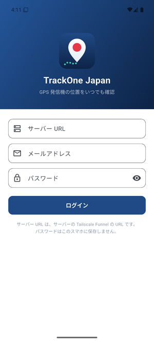

1. 「TrackOne」を開く
2. **サーバー URL**：[サーバーの準備](#1-サーバーの準備)の手順7で控えた `https://〇〇.ts.net`
3. **メールアドレス**・**パスワード**：管理画面で作ったアカウント
4. **「ログイン」** を押す

- 次回からは自動でログインされます（1年間有効）
- パスワードはスマホに保存されません（暗号化したログイン用の鍵だけを保存）
- `http://` で始まる URL は、開発版で PC 内のテスト用サーバーにつなぐ場合だけ使えます

<br clear="right">

### 3-3. PC アプリ（Windows 版）

パソコンでも、スマホと同じアプリ（同じ機能・同じオリジナルアイコン）が使えます。ウィンドウが広いときは、**左に端末一覧、右に地図と端末カード**を並べて表示します。

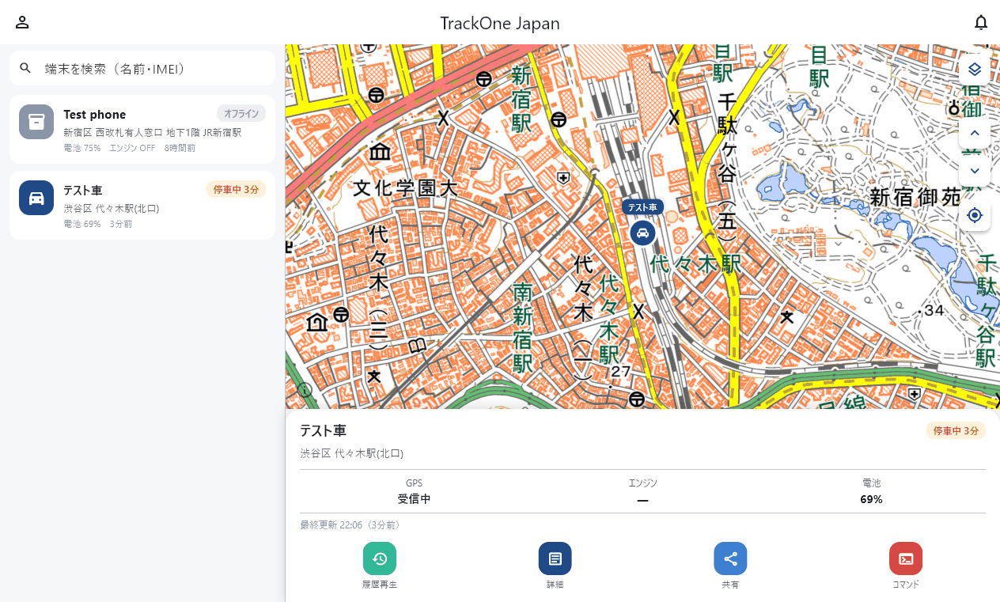

| 手順 | 内容 |
|---|---|
| 1. 入手 | 現在は開発版のため、自分でビルドします（[app/README.md の「Windows 版」](app/README.md#windows-版pc-アプリ)）。できあがった `Release` フォルダごと好きな場所に置きます（インストール不要） |
| 2. 起動 | `TrackOneJapan.exe` をダブルクリック。タイトルバーとタスクバーにオリジナルアイコンが表示されます |
| 3. ログイン | サーバー PC そのものなら `http://localhost:8082`、別の PC からは `https://〇〇.ts.net`。メールとパスワードはスマホと同じ |

スマホ版との違い:

| 項目 | Windows 版 |
|---|---|
| 画面の並び | 幅 900 ピクセル以上で一覧と地図を横に並べる。狭くするとスマホと同じ「地図／一覧」の切り替え |
| 地図の操作 | マウスのホイールで拡大・縮小、ドラッグで移動 |
| GPX 書き出し | 「名前を付けて保存」の画面で保存先を選ぶ |
| アラームの通知 | Windows の通知センターに表示（アプリを起動している間） |
| 位置共有・SMS の文面 | 「送る」の代わりに **コピー**。メールやスマホに貼り付けて使う |

---

## 4. アプリの使い方

> 画面の説明はスマホ版の写真ですが、PC アプリ（Windows 版）も同じ操作で使えます。

### 4-1. ホーム（地図）

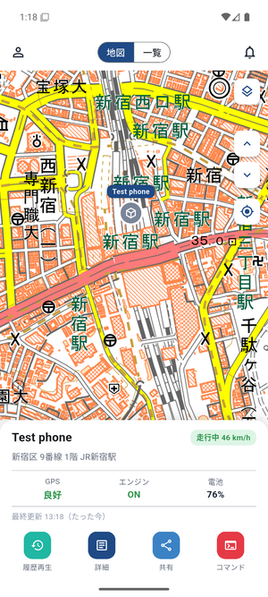

アプリを開くと最初に表示される画面です。登録した発信機の位置が地図に表示されます。

| 場所 | 機能 |
|---|---|
| 左上 👤 | マイページを開く |
| 上部「地図／一覧」 | 地図と一覧を切り替え |
| 右上 🔔 | [アラーム一覧](#4-4-アラーム通知)を開く。未読があると赤い数字で件数を表示 |
| 右側 ◇（重なった四角） | [地図の種類](#4-6-地図の種類)を切り替え |
| 右側 ▲ ▼ | 前／次の発信機に切り替え（複数台のとき） |
| 右側 ◎ | 選択中の発信機の位置へ地図を移動 |
| 地図上のアイコン | 発信機。タップすると選択（名前の札が紺色になる） |

- 地図は 2 本指で拡大・縮小、1 本指で移動できます
- 走行中も地図は自動では追いかけません。位置を見たいときは ◎ を押してください
- 通信が切れると左上に「再接続中…」と表示され、自動でつなぎ直します

<br clear="right">

### 4-2. 端末カード（地図の下）

選択中の発信機の情報です。新しい位置が届くと自動で更新されます。

| 表示 | 意味 |
|---|---|
| **走行中 46 km/h**（緑） | 動いている。速度を表示 |
| **停車中 23分**（橙） | 止まっている。止まってからの時間を表示（Traccar が停車と判定するまで数分かかり、その間は「停車中」のみ） |
| **オフライン**（灰） | 発信機から一定時間通信がない（電源オフ・圏外・SIM 切れなど） |
| 住所 | 現在地の住所。**タップすると取り直し**ます |
| GPS | 衛星の受信状態。**良好**（8個以上）／**普通**（4〜7個）／**弱い**（3個以下）／**測位なし**（位置が取れていない） |
| エンジン | ON／OFF（発信機が車の ACC 線につながっている場合。対応していなければ「—」） |
| 電池 | 発信機の電池残量。20% 未満は赤字 |
| 最終更新 | 最後に位置を測った時刻と「〇分前」 |

下のボタン：

| ボタン | 機能 |
|---|---|
| **履歴再生** | [走行ルートの再生](#4-3-履歴再生)を開く |
| **詳細** | [端末の詳細](#4-7-端末の詳細)を表示 |
| **共有** | [位置共有リンク](#4-10-位置共有)を作って送る |
| **コマンド** | [発信機へのコマンド](#4-11-コマンド遠隔操作)を送る |

### 4-3. 履歴再生

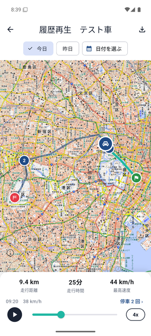

端末カードの **「履歴再生」** で開きます。その日に走ったルートを地図に描き、早送りで再生できます。

| 場所 | 機能 |
|---|---|
| 上部「今日／昨日／日付を選ぶ」 | 見たい日を選ぶ（過去 1 年まで） |
| 地図の線 | **青緑＝再生済み**、**紺＝これから通る道** |
| 🟢 旗 | その日の出発地点 |
| 🔴 旗 | その日の最後の地点 |
| ①②… 番号 | 停車した場所。**タップすると到着・出発時刻、停車時間、住所**を表示 |
| 車のアイコン | 再生中の現在地 |
| 走行距離・走行時間・最高速度 | その日の合計 |
| 時刻と速度（例：09:20　38 km/h） | 再生中の地点の測位時刻と速度 |
| 「停車 2 回 ›」 | 停車地点の一覧を開く。タップでその場所へ移動 |
| ▶／⏸ | 再生・一時停止 |
| つまみ（スライダー） | 動かして好きな時刻へ移動 |
| 「4x」 | 再生速度を 1x → 2x → 4x → 8x → 16x と切り替え |
| 右上 ⬇ | その日のルートを **GPX ファイル**で書き出し、LINE・メール・Google ドライブなどへ送る（Google マップや他の地図アプリで開けます） |

- 再生中に車が画面の外に出ると、地図が自動で追いかけます
- 記録がない日は「この日の走行記録はありません」と表示されます
- 「停車」は、Traccar が 5 分以上止まっていたと判定した場所です

<br clear="right">

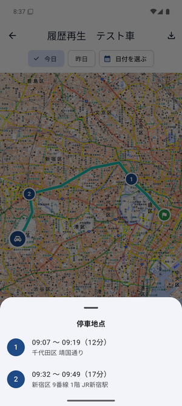

### 4-4. アラーム（通知）

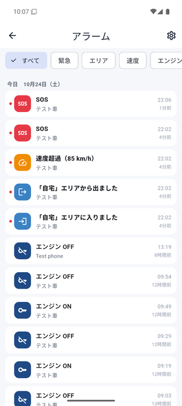

ホーム右上の 🔔 で開きます。SOS・エリアの出入り・速度超過などのアラームを、新しい順に一覧で見られます。

**はじめに一度だけ**：一覧の上に「リアルタイムでアラームを受け取る種類が設定されていません」と出たら、**「おすすめ設定にする」** を押してください。これで警報・エリアの出入り・速度超過・通信の途絶が届くようになります（あとから[通知の設定](#通知の設定)で変えられます）。

| 場所 | 機能 |
|---|---|
| 上部「すべて／緊急／エリア／速度…」 | 種類で絞り込み（実際に起きた種類だけ表示） |
| 各行 | アラームの内容・端末名・時刻。**赤い点＝未読** |
| 行をタップ | [アラームの詳細](#アラームの詳細)を開く |
| 右上 ⚙ | [通知の設定](#通知の設定)を開く |
| 下に引っ張る | 最新の状態に更新 |

- 過去 7 日間のアラームを表示します
- 一覧を開くと、ホームの 🔔 の未読数は 0 に戻ります
- 「移動を開始」「停車」は件数が多いため一覧には出しません（停車時間は端末カードに表示）

<br clear="right">

**アラームの色の意味**

| 色 | 種類 | 例 |
|---|---|---|
| 🔴 赤 | 緊急 | SOS、取り外し・いたずら、事故・転倒、GPS アンテナ切断 |
| 🔵 青 | エリア | 「自宅」エリアに入りました／出ました |
| 🟠 橙 | 速度・電源 | 速度超過（85 km/h）、電源が切断されました、電池残量が低下 |
| 🔷 紺 | エンジン | エンジン ON／OFF |
| ⚪ 灰 | 通信 | 通信が途絶えました／再開しました |

#### アラームの詳細

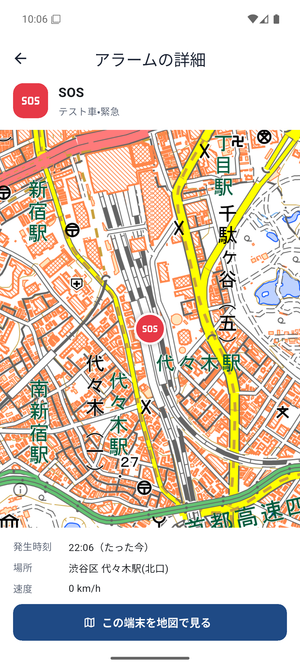

発生した場所を地図で表示し、**発生時刻・場所（住所）・速度**を確認できます。
**「この端末を地図で見る」** で、その発信機の今の位置に移動します。

<br clear="right">

#### スマホへの通知

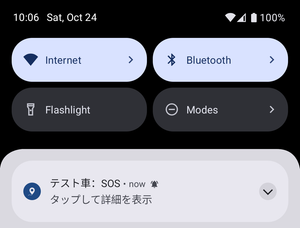

アラームが届くと、スマホの通知欄に **「テスト車：SOS」** のように表示されます（オリジナルアイコン付き）。通知をタップすると、そのアラームの詳細が開きます。

- 初めて起動したときに「通知を許可しますか？」と聞かれたら **「許可」** を選んでください
- **アプリが動いている間**（画面を閉じていても、アプリを終了していなければ）通知が届きます
- **アプリを完全に終了しているとき**にも届けるには、サーバーにプッシュ通知（Firebase）の設定が必要です（[よくある質問](#よくある質問)参照）

<br clear="right">

#### 通知の設定

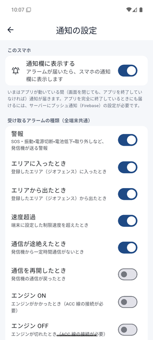

アラーム一覧の ⚙、またはマイページの「通知の設定」で開きます。

| 項目 | 内容 |
|---|---|
| 通知欄に表示する | このスマホの通知欄に出すかどうか（このスマホだけの設定） |
| 受け取るアラームの種類 | 警報、エリアに入ったとき／出たとき、速度超過、通信が途絶えたとき／再開したとき、エンジン ON／OFF、コマンドの結果 |
| おすすめ設定にする | よく使う 5 種類（警報・エリアの出入り・速度超過・通信途絶）をまとめてオン |

- 受け取る種類の設定はサーバーに保存され、同じアカウントの他のスマホやブラウザにも反映されます
- 速度超過を使うには、端末の **速度制限** を設定してください（[端末の設定](#4-12-端末の追加設定の変更)、または管理画面）
- エリアの出入りを使うには、[エリア（ジオフェンス）](#4-9-エリアジオフェンス)を作って端末を選んでください

<br clear="right">

### 4-5. 一覧

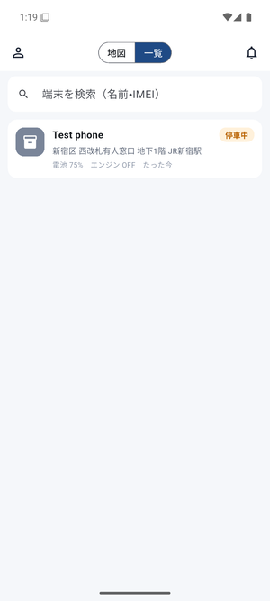

上部の「一覧」を押すと、すべての発信機を一覧で見られます。

- 各行に **状態・住所・電池・エンジン・最終更新** を表示
- 上の検索欄で **名前や IMEI** で絞り込み
- 画面を **下に引っ張ると最新の情報に更新**
- 行をタップすると、その発信機を選んで地図に戻ります
- 一番下の **「＋ 端末を追加」** で発信機を登録できます（[4-12](#4-12-端末の追加設定の変更)）

<br clear="right">

### 4-6. 地図の種類

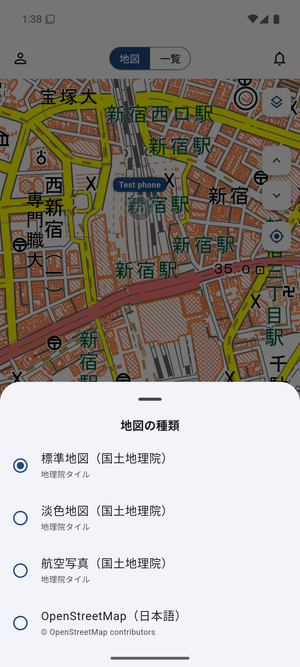

地図右側の ◇ ボタン、またはマイページの「地図の種類」で切り替えます。選んだ地図は次回も使われます。

| 地図 | 特徴 |
|---|---|
| 標準地図（国土地理院） | 初期設定。日本の公式地図。文字が大きめ |
| 淡色地図（国土地理院） | 色が薄く、アイコンが見やすい |
| 航空写真（国土地理院） | 写真で周囲の様子がわかる |
| OpenStreetMap（日本語） | すっきりした見た目。店や施設名が多い |

どれも無料・登録不要です。地図左下の ⓘ で出典を確認できます。

<br clear="right">

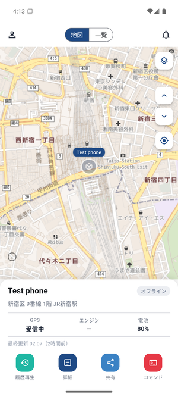 

### 4-7. 端末の詳細

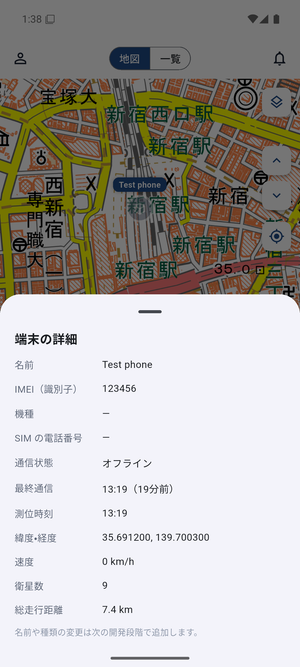

端末カードの **「詳細」** で表示します。

| 項目 | 内容 |
|---|---|
| 名前・IMEI | 管理画面で登録した内容 |
| 機種・SIM の電話番号 | 管理画面で入力した場合に表示 |
| 通信状態・最終通信 | オンライン／オフラインと最後に通信した時刻 |
| 測位時刻・緯度経度 | 最後に測った時刻と座標（長押しでコピー可） |
| 速度・衛星数 | 測位時の速度と受信している衛星の数 |
| 総走行距離 | Traccar が計算した累計距離 |

下の **「端末の設定を変更」** で、名前・アイコン・SIM の電話番号・速度制限などを変えられます（[4-12](#4-12-端末の追加設定の変更)）。

<br clear="right">

### 4-8. マイページ

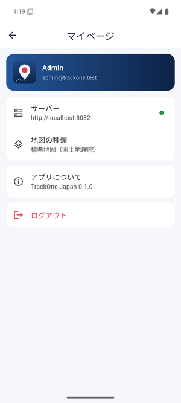

左上の 👤 で開きます。

| 項目 | 内容 |
|---|---|
| アカウント | ログイン中の名前とメールアドレス |
| サーバー | 接続先の URL。右の点が **緑＝接続中**、**灰＝再接続中** |
| 地図の種類 | 地図の切り替え |
| 通知の設定 | 受け取るアラームの種類、通知欄への表示（[通知の設定](#通知の設定)） |
| エリア（ジオフェンス） | 自宅・職場などのエリアの作成・編集（[4-9](#4-9-エリアジオフェンス)） |
| アプリについて | バージョン、使用しているソフトのライセンス |
| ログアウト | このスマホのログイン情報を削除（サーバー側の鍵も無効化） |

<br clear="right">

### 4-9. エリア（ジオフェンス）

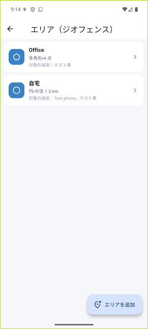

自宅・職場・学校などを「エリア」として登録すると、発信機がそこに **入ったとき・出たとき** に通知が届きます（[アラーム](#4-4-アラーム通知)にも記録されます）。マイページの **「エリア（ジオフェンス）」** で開きます。

- 一覧には、エリアの形（円・多角形）・大きさ・対象の端末が表示されます
- 右下の **「エリアを追加」** で新しく作ります。行をタップすると編集できます
- ホームの地図にも、登録したエリアが薄い青で表示されます
- 「エリアに入った・出たときの通知がオフです」と出たら **「オンにする」** を押してください

<br clear="right">

**エリアの作り方**

<p>
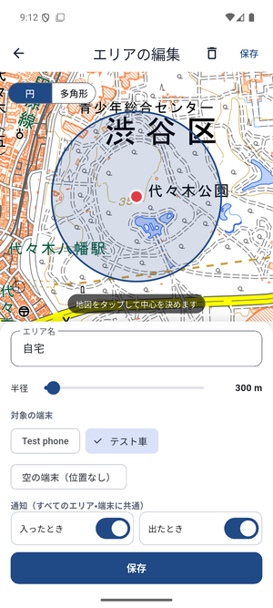
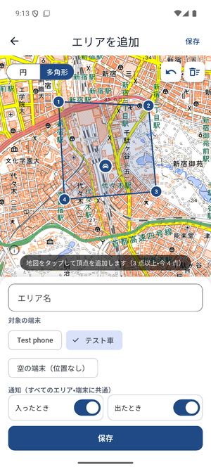
</p>

| 手順 | 円（左） | 多角形（右） |
|---|---|---|
| 1 | 左上で **「円」** を選ぶ | 左上で **「多角形」** を選ぶ |
| 2 | 地図をタップして **中心** を決める（はじめは選択中の端末の位置） | 地図をタップして **頂点** を 3 つ以上置く（番号が付く） |
| 3 | **半径** をスライダーで調整（50 m〜5 km） | 間違えたら右上の ↶（1 つ戻す）・🗑（すべて消す） |
| 4 | **エリア名**（例：自宅）を入れる | 同じ |
| 5 | **対象の端末** を選ぶ（選んだ端末だけが通知の対象） | 同じ |
| 6 | **「保存」** | 同じ |

- 「通知（すべてのエリア・端末に共通）」のスイッチは、エリアに入ったとき・出たときの通知をまとめてオン・オフします
- 削除するときは、編集画面の右上のゴミ箱を押します
- 管理画面で作った線（ルート）型のエリアは、アプリでは表示・編集できません（管理画面で編集してください）

### 4-10. 位置共有

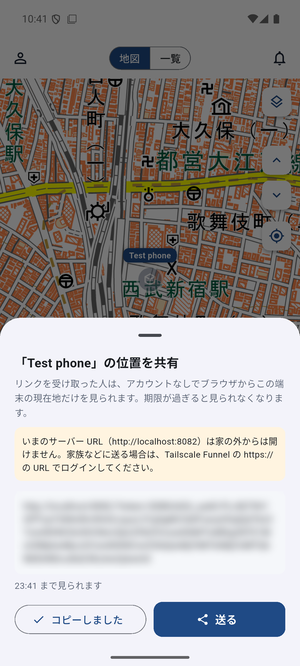

端末カードの **「共有」** で開きます。**期限付きのリンク** を作り、家族や友人に送ると、相手は **アカウントもアプリも不要** で、ブラウザからその発信機の現在地だけを見られます。

1. **見られる期間** を選ぶ（1 時間／24 時間／7 日間）
2. **「共有リンクを作る」**
3. **「送る」** で LINE・メールなどを選んで送信（**「コピー」** で貼り付けも可）

- 期限が過ぎると、リンクを開いても見られなくなります
- 相手に見えるのは **共有した発信機だけ** です（他の発信機や設定は見えません）
- リンクは `https://〇〇.ts.net` の URL でログインしているときに作ってください。`http://localhost` や `http://192.168.…` でログインしていると、家の外からは開けません（画面に注意が出ます）
- PC アプリには「送る」ボタンがありません。「コピー」して、メールやチャットに貼り付けてください

<br clear="right">

### 4-11. コマンド（遠隔操作）

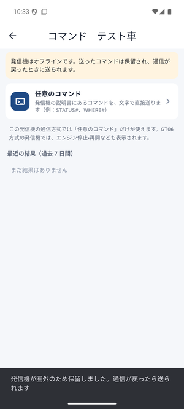

端末カードの **「コマンド」** で開きます。発信機に命令を送り、状態の問い合わせや設定の変更ができます。

| 表示されるコマンドの例 | 内容 |
|---|---|
| 任意のコマンド | 発信機の説明書にある文面（例：`STATUS#`、`WHERE#`）をそのまま送る |
| 位置の問い合わせ | 今すぐ位置を送らせる |
| 送信間隔の変更 | 位置を送る間隔（秒）を変える |
| エンジン停止／再開 | 車の燃料ポンプなどを止める・戻す（配線した発信機のみ。**赤色**で表示され、2 回確認します） |

- 表示されるコマンドは、発信機の機種（通信方式）によって変わります。GT06 方式（WanWay など）では「任意のコマンド」「エンジン停止／再開」などが出ます
- 発信機が **オフライン** のときに送ったコマンドは、サーバーで **保留** され、通信が戻ったときに自動で送られます（「保留しました」と表示）
- 発信機からの返事は、画面下の **「最近の結果（過去 7 日間）」** に表示されます
- **エンジン停止は走行中に使わないでください**。安全な場所に止まっているときだけ使ってください

<br clear="right">

### 4-12. 端末の追加・設定の変更

<p>
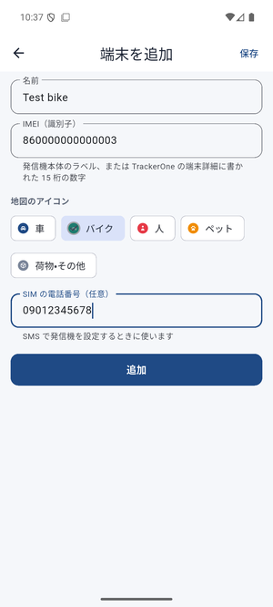
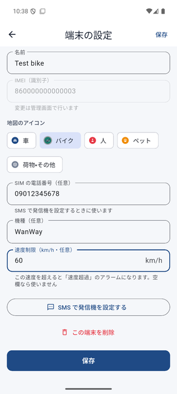
</p>

**追加**：一覧の一番下の **「＋ 端末を追加」**（左の画面）
**変更**：端末カードの「詳細」→ **「端末の設定を変更」**（右の画面）

| 項目 | 内容 |
|---|---|
| 名前 | 地図や一覧に出る名前（例：車、子どもの自転車） |
| IMEI（識別子） | 発信機の 15 桁の番号。本体のラベル、または TrackerOne の端末詳細に書かれています（追加のときだけ入力。あとからの変更は管理画面で） |
| 地図のアイコン | 車／バイク／人／ペット／荷物・その他 |
| SIM の電話番号 | 発信機に入っている SIM の番号。[SMS で発信機を設定](#4-13-sms-で発信機を設定)するときの宛先になります |
| 機種 | メモ用（例：WanWay S20） |
| 速度制限（km/h） | この速度を超えると「速度超過」のアラーム。空欄なら使いません |

- 削除は設定画面の **「この端末を削除」**。位置の履歴やアラームも消え、元に戻せません
- 家族のアカウントでは、管理者の設定によって追加・変更・削除ができない場合があります

<br clear="right">

### 4-13. SMS で発信機を設定

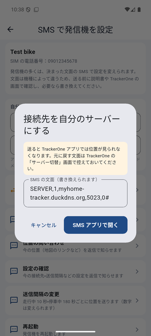

「端末の設定」画面の **「SMS で発信機を設定する」** で開きます。発信機の多くは決まった文面の SMS で設定を変えられるので、その文面づくりと送信を手伝います（TrackerOne の「サーバー切替」に相当）。

1. 上の **ドメイン**（DuckDNS のドメイン）と **ポート**（ルーターで開けた外部ポート）を入れる（次回も残ります）
2. 送りたい項目を押す → 文面を確認・必要なら書き換える
3. **「SMS アプリで開く」** → 宛先（SIM の電話番号）と文面が入った状態で SMS アプリが開くので、送信ボタンを押す

| 項目 | 文面の例 | 内容 |
|---|---|---|
| 接続先を自分のサーバーにする | `SERVER,1,ドメイン,5023,0#` | 位置の送り先を自分のサーバーに変える（TrackerOne では見られなくなります） |
| 状態の確認 | `STATUS#` | 電池・GPS・通信の状態を返信で知らせる |
| 位置の問い合わせ | `WHERE#` | 今の位置を返信で知らせる |
| 設定の確認 | `PARAM#` | 今の接続先・送信間隔を返信で知らせる |
| 送信間隔の変更 | `TIMER,10,180#` | 走行中 10 秒・停車中 180 秒ごとに送る |
| 再起動 | `RESET#` | 発信機を再起動する |

- 文面は GT06 系の一般的な形式です。**機種によって違う** ので、説明書や TrackerOne の画面で確認してから送ってください
- SIM の電話番号が未登録のときや PC アプリでは、文面を **コピー** します。スマホの SMS アプリに貼り付けて送ってください
- SMS の送信料は、スマホの契約に応じてかかります

<br clear="right">

---

## 5. 管理画面（ブラウザ）の使い方

サーバー PC のデスクトップの **「TrackOne 管理画面」**、またはスマホ・PC のブラウザで `https://〇〇.ts.net` を開きます（画面は日本語で表示されます）。

| やりたいこと | 操作 |
|---|---|
| 発信機を追加 | 地図画面左上の「＋」 → 名前と IMEI（アプリの「＋ 端末を追加」でも可） |
| 発信機の名前・アイコン（カテゴリ）・電話番号を変更 | 一覧で発信機を選び、鉛筆アイコン（アプリの「端末の設定を変更」でも可） |
| 家族のアカウントを作る | 左下のメニュー「設定」→「ユーザー」→「＋」、作成後に「デバイス」で見られる発信機を割り当て |
| 速度超過の基準を決める | 発信機の編集 →「属性」→ 速度制限（単位はノット。アプリなら km/h で入力できます） |
| エリア（ジオフェンス）を作る | 左下のメニュー「設定」→「ジオフェンス」→ 地図上で円や多角形を描いて名前を付ける → 発信機の編集の「接続」でそのエリアを割り当て（アプリの「エリア（ジオフェンス）」でも作れます） |
| 過去のルートを表で見る・Excel で保存 | 「レポート」→「ルート」「停止」「トリップ」（地図での再生はアプリの「履歴再生」が便利） |

> 2 人目以降は自由に登録できない設定（初期状態）です。家族の分は管理者が「ユーザー」から作ってください。

---

## 6. 日常の運用

サーバーは自動で動き続けます。普段の操作は不要です。

| 自動で行われること | 内容 |
|---|---|
| 自動起動 | 再起動・停電復帰後もサービスが自動で立ち上がる |
| 死活監視 | 5 分ごとにチェックし、止まっていたら自動で再起動 |
| バックアップ | 毎日 3:00 にデータベースを保存（14 日分） |
| DuckDNS 更新 | 自宅の IP が変わったら 5 分以内に追従 |

| 手動でやりたいこと | 方法（管理者 PowerShell） |
|---|---|
| 今すぐバックアップ | `C:\TrackOneServer\scripts\backup.ps1` |
| バックアップから戻す | `C:\TrackOneServer\scripts\restore.ps1` |
| Traccar を新しい版に更新 | `C:\TrackOneServer\scripts\update-traccar.ps1 -Version 6.17.0` |
| 状態を確認 | `C:\TrackOneServer\logs\healthcheck-YYYYMM.log` を開く |
| PC を買い替える | [04_サーバー構築手順.md の「PC を買い替える・移設するとき」](docs/04_サーバー構築手順.md#pc-を買い替える移設するとき) |

---

## 困ったとき

### アプリにログインできない

| 表示されるメッセージ | 原因と対処 |
|---|---|
| メールアドレスまたはパスワードが違います | 管理画面でログインできるか確認。大文字・小文字にも注意 |
| サーバーに接続できません。URL とネットワークを確認してください | URL の打ち間違い、サーバー PC の電源、Tailscale Funnel が有効か（`tailscale funnel status`）を確認 |
| サーバーが応答しません | サーバー PC が重い・ネットワークが不安定。少し待って再試行 |
| URL は https:// で始まる必要があります | `https://〇〇.ts.net` の形で入力（`http://` は開発版のテスト時のみ） |
| ログインの有効期限が切れました | サーバーで保存済みのログインが無効になった（管理画面で削除・期限切れ）。もう一度ログインする |
| 起動すると「サーバーに接続できません」の画面になる | サーバー PC が動いていれば **「もう一度試す」**。サーバーの URL が変わった・別のサーバーを使う場合は **「別のサーバー・アカウントでログイン」** でログイン画面に戻る |

### 発信機が「オフライン」のまま・位置が出ない

1. 管理画面でも「オフライン」か確認
2. サーバー PC の `C:\Program Files\Traccar\logs\tracker-server.log` を開き、`gt06` と IMEI の行があるか確認
   - **行がない** → ルーターのポート転送、DuckDNS、SMS の設定文（ドメイン・ポート）を確認
   - **`Unknown device` と出る** → 管理画面に登録した IMEI の間違い
   - **接続はあるが位置が 0** → 発信機を屋外に置いて GPS を受信させる（停車中は位置を送らない機種もある）
3. 発信機の SIM の残高・有効期限を確認

### アラーム・通知が届かない

| 症状 | 原因と対処 |
|---|---|
| 一覧に新しいアラームがすぐ出ない | 受け取る種類が未設定。アラーム一覧の「おすすめ設定にする」または[通知の設定](#通知の設定)でオンにする |
| 一覧には出るが通知欄に出ない | スマホの「設定 → アプリ → TrackOne → 通知」が許可されているか、[通知の設定](#通知の設定)の「通知欄に表示する」がオンか確認 |
| アプリを終了すると通知が来ない | 現在の仕様です（プッシュ通知には Firebase の設定が必要）。アプリを終了せず、ホームボタンで閉じてください |
| 速度超過が来ない | [端末の設定](#4-12-端末の追加設定の変更)（または管理画面）で速度制限を設定する |
| エリアの出入りが来ない | エリアの「対象の端末」に発信機が選ばれているか、エリアの通知がオンか確認する |

### アプリの表示がおかしい

| 症状 | 対処 |
|---|---|
| 地図が灰色のまま | スマホのネットワークを確認。地図の種類を切り替えてみる |
| 「住所を取得中…」のまま | 住所変換サービスの混雑。住所をタップして取り直す |
| 「再接続中…」が消えない | サーバー PC と Tailscale を確認。アプリを閉じて開き直す |
| 停車時間が出ない | 止まってから数分は「停車中」のみ表示（Traccar の判定待ち） |
| エンジンが「—」 | 発信機がエンジン（ACC）の情報を送っていない |

### 共有・コマンド・SMS がうまくいかない

| 症状 | 原因と対処 |
|---|---|
| 共有リンクを相手が開けない | `https://〇〇.ts.net` でログインしてリンクを作り直す（`localhost` や `192.168.…` のリンクは家の外から開けない）。期限切れなら作り直す |
| コマンドが「保留しました」のまま | 発信機がオフライン。電源・電波・SIM を確認すると、通信が戻ったときに自動で送られる |
| 「任意のコマンド」しか出ない | 発信機の通信方式がそれ以外に対応していない。説明書の文面を「任意のコマンド」で送る |
| SMS を送っても返事がない | 文面の形式が機種と違う、または SIM の電話番号の間違い。TrackerOne や説明書で形式を確認する。パスワード付きの形式（例：`SERVER,123456,…`）の機種もある |
| 端末を追加できない | IMEI がすでに別の端末で使われている、または家族アカウントで追加が許可されていない（管理者に依頼） |

---

## よくある質問

**Q. アプリを閉じていても通知は届きますか？**
A. アプリが動いている間（ホームボタンで閉じた状態を含む）は届きます。アプリを完全に終了している、またはスマホが電池節約のためにアプリを止めたときにも届けるには、Google の Firebase（無料）でプッシュ通知の設定が必要です。Firebase のプロジェクト作成にはご自身の Google アカウントが必要なため、現在は未対応です。

**Q. 本当に無料ですか？**
A. ソフトとサービスはすべて無料です。発信機の SIM の通信費と、サーバー PC の電気代だけかかります。

**Q. パソコンでも見られますか？**
A. はい。Windows 版の PC アプリ（[3-3](#3-3-pc-アプリwindows-版)）が使えます。ブラウザで管理画面（`https://〇〇.ts.net`）を開いて見ることもできます。

**Q. iPhone で使えますか？**
A. アプリとしての配布には Apple の有料登録が必要なため、現在は Android のみです。iPhone では Safari で `https://〇〇.ts.net` を開き、共有ボタン →「ホーム画面に追加」で、オリジナルアイコン付きの管理画面として使えます。

**Q. TrackerOne アプリと同時に使えますか？**
A. 使えません。発信機の送信先は 1 か所だけなので、自分のサーバーに切り替えると TrackerOne では見られなくなります（元の設定文を送れば戻せます）。

**Q. 位置データはどこに保存されますか？**
A. 自宅のサーバー PC（PostgreSQL）だけです。メーカーや第三者のクラウドには送られません。

**Q. 家族と一緒に見られますか？**
A. 管理画面で家族用のアカウントを作り、見せたい発信機を割り当ててください。各自のスマホでアプリにログインできます。一時的に見せるだけなら、アカウント不要の[位置共有リンク](#4-10-位置共有)が便利です。

**Q. 発信機は何台まで登録できますか？**
A. 制限はありません。数十台程度までは同じ構成で問題なく動きます。

---

## 現在の状況と今後の予定

| 段階 | 状態 |
|---|---|
| TrackerOne の解析 | ✅ 完了（[01](docs/01_TrackerOne解析レポート.md)、[02](docs/02_APK解析結果.md)） |
| サーバー設計・構築スクリプト | ✅ 完了（[03](docs/03_サーバー設計.md)、[04](docs/04_サーバー構築手順.md)） |
| テスト PC でのサーバー動作確認 | ✅ 完了（起動・位置受信・アイコン・バックアップ・死活監視） |
| アプリ 段階1：ログイン・地図・一覧・端末カード・リアルタイム更新 | ✅ 完了（Android エミュレーターで確認。実機スマホは未確認） |
| アプリ 段階2：履歴再生（日付選択・再生・停車地点・GPX 書き出し） | ✅ 完了（Android エミュレーターで確認） |
| アプリ 段階3：アラーム一覧・詳細・通知設定・スマホへの通知 | ✅ 完了（エミュレーターで確認）。アプリを終了しているときのプッシュ通知（Firebase）は未対応 |
| PC アプリ（Windows 版）：段階1〜3 の全機能、横並びの画面、GPX 保存、通知センター | ✅ 完了（この PC で自動テスト・実行確認） |
| アプリ 段階4：エリア（ジオフェンス）の作成・編集・削除、地図への表示 | ✅ 完了（エミュレーター・Windows で確認） |
| アプリ 段階5：コマンド・位置共有・端末の追加と設定・SMS 設定 | ✅ 完了（エミュレーター・Windows で確認。実際の発信機へのコマンド・SMS は未確認） |
| アプリ 段階6：仕上げ・APK の配布（GitHub Releases） | 予定 |
| 実機（発信機）での接続確認 | 未実施（本番サーバーの準備後） |

アプリの設計は [docs/05_アプリ設計.md](docs/05_アプリ設計.md)、全画面のイメージは [docs/mockups/app-mockups.png](docs/mockups/app-mockups.png) を参照してください。

---

## フォルダ構成・資料

```
docs/              解析レポート・設計書・構築手順・画面写真
server/windows/    サーバーのインストール・運用スクリプト（PowerShell）
app/               アプリ（Flutter。Android 版と Windows 版を同じコードから作る）。開発者向けの説明は app/README.md
assets/icon/       オリジナルアイコン（SVG 原本と各サイズの PNG / ICO）
```

| 資料 | 内容 |
|---|---|
| [01_TrackerOne解析レポート.md](docs/01_TrackerOne解析レポート.md) | TrackerOne の機能（公開情報から） |
| [02_APK解析結果.md](docs/02_APK解析結果.md) | TrackerOne アプリの構造（REA による解析） |
| [03_サーバー設計.md](docs/03_サーバー設計.md) | サーバーの構成・運用・セキュリティ |
| [04_サーバー構築手順.md](docs/04_サーバー構築手順.md) | サーバーの構築手順（詳細） |
| [05_アプリ設計.md](docs/05_アプリ設計.md) | スマホアプリの設計 |
| [app/README.md](app/README.md) | アプリのビルド・開発方法 |

### 使用しているもの

| ソフト / サービス | ライセンス・料金 |
|---|---|
| [Traccar](https://www.traccar.org/) | Apache License 2.0 |
| [PostgreSQL](https://www.postgresql.org/) | PostgreSQL License |
| [Flutter](https://flutter.dev/) | BSD 3-Clause |
| [Tailscale](https://tailscale.com/) | 個人利用は無料プラン |
| [DuckDNS](https://www.duckdns.org/) | 無料 |
| [地理院タイル（国土地理院）](https://maps.gsi.go.jp/development/ichiran.html) | 出典表示で無料 |
| [OpenStreetMap](https://www.openstreetmap.org/) / Nominatim | ODbL / 利用規約に従い低頻度で利用 |

### 注意

- 本プロジェクトは WanWay 社・TrackerOne とは関係ありません。
- TrackerOne の APK は解析のためにのみ使用し、このリポジトリには含めていません。
- 他人の車や持ち物に、本人の同意なく発信機を付けて位置を調べることは、法律で禁止されている場合があります。必ず自分の持ち物、または同意を得た対象にだけ使ってください。
