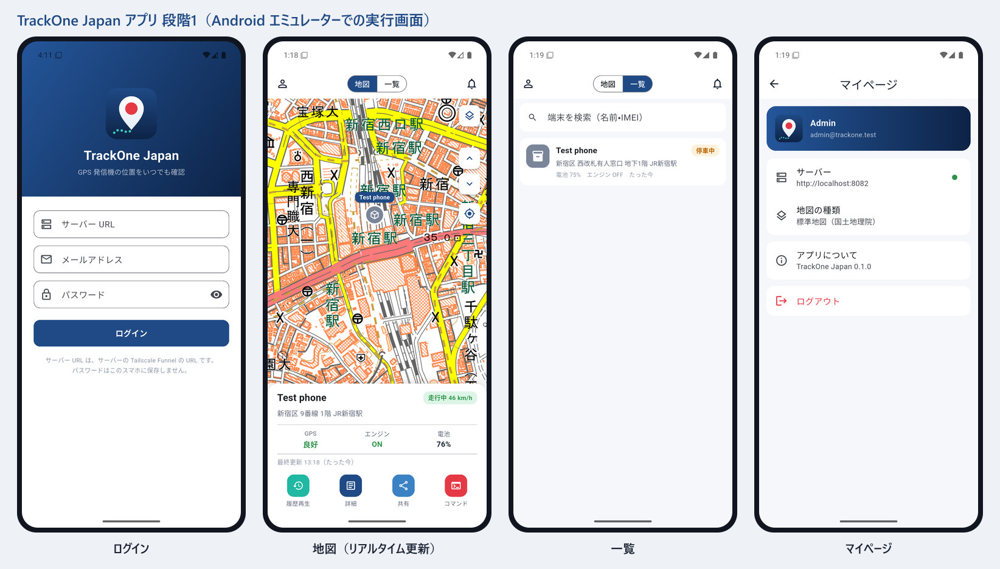

# TrackOne Japan アプリ（Flutter）

GPS 発信機の位置を日本語で確認する Android アプリです。設計は [docs/05_アプリ設計.md](../docs/05_アプリ設計.md) を参照してください。



## できること（段階1〜3）

| 機能 | 内容 |
|---|---|
| ログイン | サーバー URL・メール・パスワード。パスワードは保存せず、1年有効のトークンを暗号化保存して次回から自動ログイン |
| 地図 | 国土地理院（標準・淡色・航空写真）と OpenStreetMap（日本語）を切替。端末の種類別マーカー、前/次の端末への移動 |
| 一覧 | 全端末の状態・住所・電池・エンジン・最終更新。名前/IMEI で検索、引っ張って更新 |
| 端末カード | 走行中（速度）/ 停車中（停車時間）/ オフライン、住所、GPS・エンジン・電池、最終更新 |
| リアルタイム更新 | Traccar の WebSocket で位置・状態を即時反映。切れたら自動で再接続 |
| 端末の詳細 | IMEI・機種・SIM 番号・座標・速度など |
| 履歴再生（段階2） | 日付選択（今日・昨日・カレンダー）、ルート表示、停車地点（番号・時刻・停車時間・住所）、再生・一時停止・シーク・速度 1x〜16x、走行距離・走行時間・最高速度、GPX 書き出し・共有 |
| アラーム（段階3） | 過去 7 日間のアラーム一覧（日本語・種類別の色・絞り込み・未読の印）、詳細（発生地点の地図・時刻・住所・速度）、ホームのベルに未読数、WebSocket でリアルタイム追加 |
| 通知（段階3） | 通知の設定画面（受け取る種類をサーバーの Traccar 通知として登録、おすすめ設定）、スマホの通知欄に表示（オリジナルの通知アイコン、タップで詳細）。アプリを終了しているときのプッシュ通知（Firebase）は未対応 |
| マイページ | アカウント、サーバー、地図の種類、アプリ情報（ライセンス）、ログアウト |
| オリジナルアイコン | ホーム画面アイコン（アダプティブ・テーマアイコン対応）、起動画面、地図マーカー |

共有・コマンドのボタンは配置済みで、次の段階で中身を作ります。

> **通知の仕組み**：Traccar は「web」方式の通知設定がある種類のイベントだけを WebSocket で配信します。アプリの通知設定画面は、全端末対象（`always: true`）・`web` の通知設定を作成／削除します。「警報（alarm）」の通知は `alarms` 属性に列挙した警報しか届けないため、全種類を列挙して作成し、属性がない既存の設定は自動で修復します。

## 開発環境（このリポジトリで使ったもの）

| ツール | 場所 |
|---|---|
| Flutter 3.47.8 | `C:\dev\flutter` |
| Android SDK（platform 36, build-tools 36.1.0, NDK 28.2） | `C:\dev\android-sdk`（環境変数 `ANDROID_HOME`） |
| Dart パッケージのキャッシュ | `C:\dev\pub-cache`（環境変数 `PUB_CACHE`） |
| JDK 21（Temurin） | 環境変数 `JAVA_HOME` |
| Android Studio | winget でインストール済み（任意） |

> E ドライブ（外付け HDD）は小さなファイルの書き込みが遅いため、ツール類は C ドライブに置いています。
> プロジェクトとライブラリが別ドライブのため、`android/gradle.properties` で `kotlin.incremental=false` にしています。

## ビルドと実行

```powershell
cd E:\TrackOne\app
flutter pub get
flutter test              # 単体テスト
flutter build apk --debug # → build\app\outputs\flutter-apk\app-debug.apk
```

### テスト PC の Traccar とスマホをつないで試す

テスト PC の Traccar は PC の中（127.0.0.1:8082）でしか待ち受けていないので、USB 経由でスマホの `localhost:8082` を PC に転送します。

```powershell
adb devices                    # スマホが表示されることを確認（USB デバッグを許可）
adb install -r build\app\outputs\flutter-apk\app-debug.apk
adb reverse tcp:8082 tcp:8082  # スマホの localhost:8082 → PC の 8082
```

アプリのログイン画面で、サーバー URL に `http://localhost:8082` を入力します。
（`http://` は開発用ビルドでのみ使えます。リリース版は `https://` のみ）

位置の受信テスト（PC から送信。地図がすぐに動けば成功）:

```powershell
$now = [DateTimeOffset]::UtcNow.ToUnixTimeSeconds()
Invoke-WebRequest -UseBasicParsing "http://127.0.0.1:5055/?id=123456&lat=35.6905&lon=139.7005&speed=25&batt=76&sat=9&ignition=true&timestamp=$now"
```

### 履歴再生のテスト用データ

テスト用 Traccar に、古い時刻の位置を古い順に送ると履歴になります（OsmAnd 方式の `timestamp` に UNIX 時刻を指定）。
途中で 5 分以上同じ地点（速度 0）を送ると「停車」として記録されます。

### エミュレーターで試す

```powershell
$env:ANDROID_SDK_ROOT = 'C:\dev\android-sdk'
C:\dev\android-sdk\emulator\emulator.exe -avd TrackOneTest
```

## アイコンの作り直し

アイコン画像（`assets/icon/`）を差し替えたら:

```powershell
dart run flutter_launcher_icons
dart run flutter_native_splash:create
```

## フォルダ構成

```
lib/
  main.dart / app.dart        起動、テーマ、ログイン状態で画面を切替
  core/
    api/traccar_client.dart    Traccar の REST・WebSocket
    auth/session_store.dart    トークンの暗号化保存
    state/                     ログイン状態・端末と位置・地図の種類
    theme.dart / units.dart    配色、単位換算と日本語表記
  models/models.dart           Device / Position / Event / User
  features/
    login/                     ログイン画面
    home/                      地図・一覧・端末カード・詳細
    replay/                    履歴再生（画面と、日付範囲・再生・GPX の計算）
    alarms/                    アラーム一覧・詳細・通知の設定
    settings/                  マイページ
test/                          単体テスト（単位・URL・住所・状態・履歴再生の計算・アラームの日本語化）
core/event_labels.dart         イベント → 日本語・分類・色
core/notifications/            スマホの通知欄への表示（flutter_local_notifications）
widgets/base_map.dart          地図の背景タイルと出典表示（共通部品）
```
